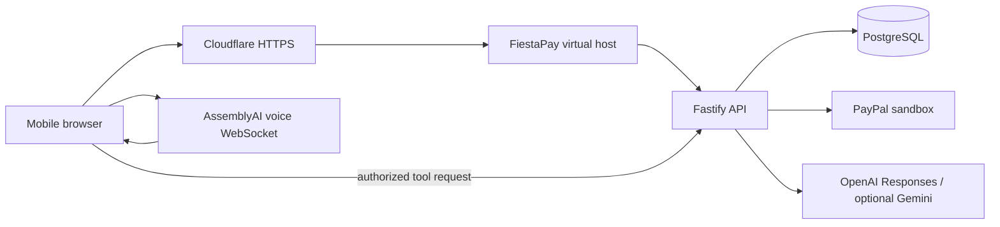

# Architecture

The same-origin React interface calls a Fastify API backed by PostgreSQL. Cloudflare fronts a dedicated Nginx virtual host on Contabo. The database has no published port. API and database have independent containers and persistent storage isolated from other applications.

Sessions use an opaque HttpOnly cookie; only its hash is stored. Organizer access is scoped to the creating session. Public invitations expose event information and the caller's own attendance, never another guest's payment details. Reset archives the prior generation; payment references remain associated with the historical event.

Money is integer USD cents calculated on the server. RSVP, payment ledger and organizer confirmation are separate concepts. Event-row locks serialize capacity changes. PayPal request IDs and unique ledger entries provide retry convergence. See financial review records and tests for the current validated behavior; code availability alone does not establish acceptance.

Chat and voice use the same tool dispatcher. Model output is untrusted. Tools cannot choose a merchant, alter a price, approve a PayPal transaction or confirm an event. Proposed RSVP changes and quotes require human confirmation. The voice API issues only short-lived provider tokens after consent and an atomic database reservation against the shared daily voice budget.

Browser audio is sent directly to AssemblyAI with a temporary token; server keys never reach the browser. FiestaPay does not persist microphone audio. Chat history is stored per event/session. Do not enter personal information; use fictional demo aliases.

The text provider is selected server-side by `LLM_PROVIDER=openai|gemini`. OpenAI is the default (`gpt-6-luna`, low reasoning). Only the selected adapter is configured; errors keep the manual flow available without switching providers. OpenAI reasoning items are encrypted and retained server-side for stateless tool continuations, never sent to the browser. Cross-provider history carries visible text without foreign tool signatures.
