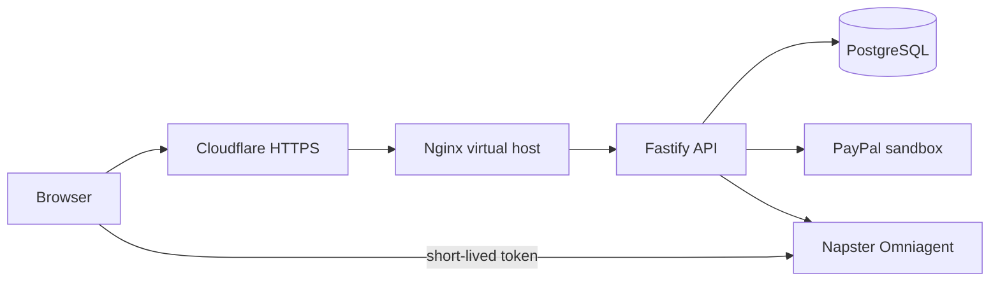

# Architecture

The same-origin React interface calls a Fastify API backed by PostgreSQL. Cloudflare fronts the Nginx virtual host on Contabo. The database has no published port. API and database run in independent containers with persistent storage isolated from other applications.

Sessions use an opaque HttpOnly cookie; only its hash is stored. Organizer access requires a separate secret link and the `X-Fiesta-Admin-Key` header. The server stores only the key digest and compares fixed-length digests in constant time. Group sites use their own host and cookie; the site admin role is checked from `memberships`. Private group events are hidden on the root and legacy hosts except from their own site admin.

Money is integer USD cents calculated on the server. RSVP, the payment ledger and organizer confirmation are separate concepts. Event-row locks serialize capacity changes. PayPal request IDs and unique ledger entries provide retry convergence. The legacy host keeps PayPal Sandbox; new group sites use provider `none` and do not offer online checkout.

The only runtime AI is Napster. The server creates a short-lived avatar connection and returns only the token and an opaque handle. The browser never receives the Napster key. The avatar uses the closed tool list from `packages/shared/src/avatar-tools.ts`; tool output is validated in the browser and the person presses the final control. There are eight implicit tools with closed JSON schemas and per-visitor allowlists. There is no other model, voice provider or fallback. If video fails, the client falls back to Napster text mode and then to the fixed tutorial script.

The legacy organizer can attach a photo avatar. The browser sends a base64 JPEG/PNG with `consent:true`; the API validates magic bytes and size, stores the image temporarily in `event_avatars`, and exposes it at `/media/avatar/{random-token}` for Napster to fetch. Napster creates a v1 companion; the API polls its status at most every 10 seconds, then copies the base agent configuration into two event agents and clears the image bytes. `POST /api/avatar-session` selects those agents when the event is ready. A delete removes both agents and the row.

Microphone use requires explicit consent and a click. The server keeps no microphone audio. Event and guest data follow the access rules in `apps/api/src/domain/access.ts`; the avatar session applies the same gate as the event page.
