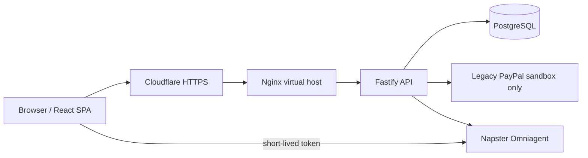
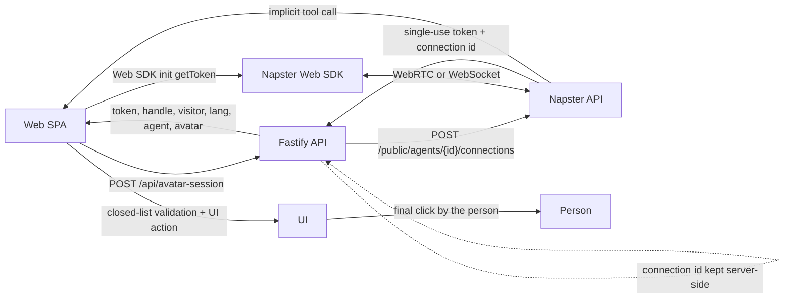

# Architecture

The same-origin React interface calls a Fastify API backed by PostgreSQL. Cloudflare fronts the Nginx virtual host on Contabo. The database has no published port. API and database run in independent containers with persistent storage isolated from other applications.

## Napster connection flow

The server creates the connection with `X-Api-Key`; the browser never sees the key. Video uses WebRTC with `videoPolicy: "deferred"`; text uses WebSocket with `modality: "text"`. The Web SDK receives only a short-lived token. Implicit tool calls are validated against closed schemas and per-visitor allowlists before the UI highlights or fills anything. The person always performs the final action; the avatar never publishes, pays, confirms, deletes or sends messages.

## Hosts, data and access

`classifyHost` separates root, legacy, site and event hosts; `GET /api/host-info` confirms the effective kind. A site without a tenant row can resolve to an event subdomain or to a free address. Event hosts expose only that event’s public/organizer API plus sessions and the public catalog. A reserved address shows the not-found page.

Sessions use an opaque HttpOnly cookie; only its hash is stored. Organizer access requires a separate secret link and the `X-Fiesta-Admin-Key` header. The server stores only the key digest and compares fixed-length digests in constant time. Group sites use their own host and cookie; the site admin role is checked from `memberships`. Private group events are hidden on the root and legacy hosts except from their own site admin.

Each meetup gets a unique `events.subdomain`, generated from the title or requested as `preferredSubdomain`, with numeric suffixes inside the creation transaction and a UNIQUE retry. `events.avatar_id` stores the catalog avatar chosen by the organizer. The guest session priority is: ready organizer photo, event avatar, default.

Money is integer USD cents calculated on the server. RSVP, the payment ledger and organizer confirmation are separate concepts. Event-row locks serialize capacity changes. PayPal request IDs and unique ledger entries provide retry convergence. The legacy host keeps PayPal Sandbox for historical events; new root meetups use provider `none`, where the share is a collection among friends and there is no quote, order or capture. Attendance still works.

## Avatar catalog and photo

`contenido/avatares.json` holds 26 avatars with `displayName`, tags, voice and one ES/EN agent pair each. `setup.mjs --catalog` copies the base agent configuration and creates the 50 catalog agents. The default avatar uses the base `NAPSTER_AGENT_ID_ES` / `NAPSTER_AGENT_ID_EN`. An optional `suggest_avatars {tag}` tool highlights catalog matches; the person chooses.

The legacy organizer can attach a photo avatar. The browser sends a base64 JPEG/PNG with `consent:true`; the API validates magic bytes and size, stores the image temporarily in `event_avatars`, and exposes it at `/media/avatar/{random-token}` for Napster to fetch. Napster creates a v1 companion; the API polls its status at most every 10 seconds, then copies the base agent configuration into two event agents and clears the image bytes. The photo avatar wins over the catalog choice for guests. A delete removes both agents and the row. The current envelope is 2 base agents + 50 catalog agents + 30 photo agents = 82 of 100.

Microphone use requires explicit consent and a click. The server keeps no microphone audio. Event and guest data follow the access rules in `apps/api/src/domain/access.ts`; the avatar session applies the same gate as the event page.
