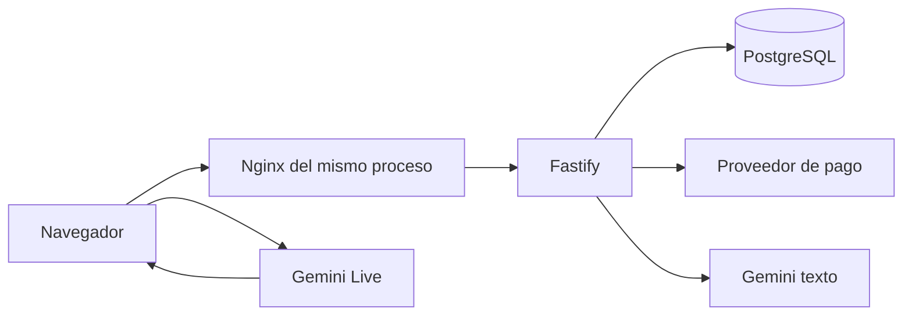

# Plan Somos Panas (SP-0)

Plan de arquitectura para convertir este repositorio en la base de somospanas.com. SP-0 entrega este documento y `PROGRESO.md`. No cambia la aplicación, no despliega y no llama a ningún procesador de pagos.

Fecha de la lectura: 20 de noviembre de 2026. Fuente leída: `3129041` en `main`.

## Meta

Un solo código y un solo despliegue sirven la portada general en la raíz y un sitio por grupo en `<grupo>.somospanas.com`. Cada sitio tiene nombre, colores, textos y módulos editables por un administrador del sitio. Los primeros sitios reales nacen privados. La portada lista solo eventos y recaudaciones que su dueño marcó como públicos. El cobro de Ecuador queda detrás de una interfaz intercambiable y PayPal sale del camino de los sitios nuevos. El sitio que hoy corre en `fiestapay.somospanas.com` sigue como sitio legado mientras dure este plan.

## Cómo se construye

Cada etapa SP-1…SP-10 es un pull request propio, pequeño, con `npm run check` verde. Este plan no autoriza a fusionarlas ni a desplegarlas. La aprobación de despliegue que exige cero migraciones no cubre SP-3 ni SP-9.

Construye composer-2.5. Verifica y rescata grok-4.7. El director asigna la etapa; el constructor no se verifica a sí mismo. Un rescate sigue en grok-4.7 y conserva el id del defecto.

Reglas de todas las etapas:

- La persona hace el paso final: publicar, marcar público, anotar una recaudación, aprobar un cobro. El asistente prepara borradores y señala la pantalla.
- Importes en centavos enteros calculados en el servidor. Una fila de `payment_ledger` sigue significando un cobro o un reembolso verificado con el procesador.
- El micrófono arranca con consentimiento y un clic. Si la voz falla, queda el texto.
- La interfaz sigue el idioma de `?lang`, luego la preferencia guardada, luego el idioma del navegador.
- Cero secretos en Git, logs, pruebas o estos documentos. Cero llamadas a PayPal, Gemini, SMTP o WhatsApp para cumplir una etapa.
- Las migraciones `0001`–`0012` no se editan. El arranque ya aplica los SQL nuevos con `apps/api/src/db/migrate.ts` y el candado de aviso `778899123`.
- Datos históricos, el libro mayor y el evento de prueba del dueño se conservan. Un backfill solo escribe el sitio legado en las filas que aún no tienen sitio.
- Código comentado en español con criterio, en el diff de la etapa. Cada archivo o módulo nuevo abre con una cabecera: qué hace y de qué depende. Cada función importante lleva un comentario corto: para qué sirve, qué recibe y qué devuelve. Cada decisión no obvia, y cada arreglo de un fallo, explica el porqué; el arreglo cita el id del defecto (D-n en `PROGRESO.md`). Lo obvio se queda sin comentario. Vale para TypeScript, SQL y pruebas nuevas. grok-4.7 rechaza la etapa si falta la cabecera, si una función importante no dice entrada y salida, si un arreglo no cita su defecto, o si los comentarios narran lo que el código ya dice.

## Lo que hay hoy

Monorepo npm (`apps/api`, `apps/web`, `packages/shared`), Node 24, TypeScript, React 18 + Vite, Fastify 5, PostgreSQL 16, Zod, Vitest. CI (`.github/workflows/ci.yml`) levanta Postgres 16 y corre `npm run check`: lint, tipos, pruebas y build. El API y la web se serializan en un contenedor (`Dockerfile`, `deploy/compose.yml`). Nginx atiende solo el nombre `fiestapay.somospanas.com` (`deploy/nginx.conf`) y reenvía `Host`. El certificado y el `server_name` son de ese único nombre. La base no publica puerto.

Desde el 20 de noviembre de 2026 la raíz `somospanas.com` y el comodín `*.somospanas.com` apuntan al VPS. Un vhost `default_server` de Nginx sirve un contenedor pequeño: «estamos construyendo la portada» en la raíz y «este subdominio puede ser tuyo» en los subdominios libres. El `deploy/nginx.conf` de este repo sigue nombrando solo `fiestapay.somospanas.com`. El corte de la raíz hacia esta app es un encargo aparte del dueño, fuera de SP-1–SP-10.

Identidad. No hay cuentas. `sessions` guarda el sha256 de una cookie HttpOnly `fp_session`, sin atributo `Domain` (`apps/api/src/lib/session.ts`). El organizador de cada evento es esa sesión más una clave cuyo hash vive en `events.admin_key_hash`. La cookie del creador no autoriza el panel. Los eventos con `access_code_hash` exigen un código. Eso es un cerrojo del evento, no una bandera de “aparece en la portada”. `GET /api/events` devuelve solo los eventos de la sesión organizadora.

Datos. Doce migraciones, de `0001_init.sql` a `0012_public_chat_budget.sql`. `events.slug` es único en toda la base. Cada evento exige `template` (`comida`, `casa`, `viaje`, `evento`), `meal` y `price_cents >= 1`. El financiamiento (`0007`) es una cuota fija con mínimo y, si vence, reembolsos PayPal. El README deja fuera de alcance los fondos abiertos, los depósitos y el reparto de gastos. El libro `payment_ledger` es de solo acumulación, con unicidad `(kind, external_id)`.

Pagos. `PayPalAdapter` (`apps/api/src/paypal/types.ts`) ya es una costura: las pruebas inyectan un falso y el navegador no puede elegirlo. El dominio (`domain/orders.ts`, `domain/payments.ts`, `routes/payments.ts`) habla tipos, columnas e ids de PayPal (`paypal_order_id`, `payee_merchant_id`, moneda USD). El webhook es `POST /api/paypal/webhook`. La web carga `@paypal/paypal-js`. Un solo `PUBLIC_ORIGIN` arma las URLs de retorno. `isAllowedOrigin` (`apps/api/src/lib/origin.ts`) compara contra la lista exacta `ALLOWED_ORIGINS` + `PUBLIC_ORIGIN`.

Voz y texto. El mismo despachador de herramientas. Texto `gemini-3.5-flash`, voz `gemini-3.8-live` con token efímero de un solo uso. Audiencias `public`, `guest` y `organizer`. `show_on_screen` solo abre ids de `packages/shared/src/ui-guide.ts`. Presupuesto global en `ai_requests` y `voice_leases`. OpenAI y AssemblyAI quedan como rollback de configuración.

Portada actual. `apps/web/src/views/LandingView.tsx` es la portada de FiestaPay (crear invitación, demo de jueces). La paleta y las fuentes pedidas ya están en `apps/web/src/index.css` y en Fontsource (Nunito Sans, Manrope): `#F7FAFC`, `#12263A`, `#4A5D73`, `#125FE6`, `#0B8075`, `#FFC85A`, `#E85D4A`.

Pruebas. El proyecto API de Vitest corre archivos en serie por un candado de Postgres. El harness (`apps/api/test/harness.ts`) configura PayPal sandbox de prueba. Sin `DATABASE_URL` las pruebas de integración se omiten, no se dan por verdes. Hay del orden de cien archivos de prueba entre API y web.

## Arquitectura propuesta



El proveedor de pago de un sitio nuevo es `none`: la caja existe y no llama a ninguna red. El sitio legado `fiestapay` conserva el adaptador PayPal sandbox.

### Resolución del sitio por Host

Una función pura clasifica el encabezado `Host` (con puerto recortado, en minúsculas):

| Host | Clase |
| --- | --- |
| ausente, `localhost`, `127.0.0.1` en desarrollo y pruebas | legado `fiestapay`, para que la suite actual siga verde |
| `fiestapay.somospanas.com` | legado `fiestapay` |
| `somospanas.com`, `www.somospanas.com` | raíz |
| una sola etiqueta `^[a-z0-9](?:[a-z0-9-]{1,30}[a-z0-9])$` más `.somospanas.com` | sitio, si esa etiqueta existe y no está reservada |
| cualquier otra cosa | 404 |

Reservados, no elegibles al crear un espacio: `www`, `api`, `mail`, `smtp`, `ftp`, `admin`, `app`, `static`, `cdn`, `assets`, `blog`, `status`, `webhook`, `paypal`, `pay`, `pagos`, `dev`, `staging`, `test`, `demo`, `fiestapay`, `muestra`, `ns1`, `ns2`, `localhost`.

La clase sale del encabezado `Host`, que Nginx ya reescribe con `$host`. Se ignora `X-Forwarded-Host`. Con `trustProxy` activo, `request.hostname` de Fastify puede obedecer un `X-Forwarded-Host` enviado por el cliente; SP-2 no usa ese valor. El día que se publique el vhost, Nginx debe fijar también `X-Forwarded-Host` al `$host`.

Una mutación solo sigue si el `Origin` es el mismo host que se acaba de clasificar. Un sitio no acepta el origen de otro sitio. La lista exacta actual se mantiene para el legado y para `localhost`, así las pruebas de `isAllowedOrigin` siguen teniendo sentido. El webhook de PayPal sigue exento de ese control y solo se registra en el host legado.

La cookie de sesión no lleva `Domain`. La raíz y cada subdominio tienen sesiones distintas aunque el nombre de la cookie siga siendo `fp_session`.

### Modelo de datos

Migración nueva `0013_tenants.sql` (SP-3), aditiva.

`tenants`: `id`, `slug` único, `kind` (`legacy`, `template`, `group`), `discoverable` boolean default false, `payment_provider` (`none` o `paypal_sandbox`), `created_at`, `created_by` nulo. La migración inserta una sola fila: slug `fiestapay`, kind `legacy`, `payment_provider = paypal_sandbox`, `discoverable = false`.

`tenant_settings`: una fila por sitio. `display_name`, `tagline`, `about` con tope de longitud, siete colores hex de la paleta, cuatro booleanos de módulo (`reuniones`, `eventos`, `recaudacion`, `asistente`). Valores iniciales: la paleta FiestaPay y los cuatro módulos encendidos. El legado recibe nombre FiestaPay.

`users`: `id`, `email`, `email_hash`, `password_hash` (scrypt de `node:crypto`, sin dependencia nueva), `created_at`. El correo es único.

`memberships`: `(tenant_id, user_id)` único, `role` `admin` o `member`.

`sessions.user_id` nulo, apuntando a `users`. Nulo conserva el invitado anónimo de hoy.

`events.tenant_id` obligatorio después de asignar la fila legado a todos los eventos existentes. `events.visibility` `private` o `public`, default `private`. `events.chargeable` boolean default true. Check: un evento `public` tiene `access_code_hash` nulo. El slug sigue siendo único en toda la base, además de único por sitio: los enlaces `/e/:slug` del legado no cambian de significado.

`ai_requests.tenant_id` y `voice_leases.tenant_id` nulos. No cambian los topes. Sirven para contar el gasto por sitio más adelante.

`handoff_codes`: hash del código, sitio, usuario, vencimiento, consumido. Lo usa el salto de la raíz al subdominio.

Índices y llaves nuevas. Cero `UPDATE` de centavos, de ids de PayPal o de slugs.

Migración `0014_collections.sql` (SP-9), también aditiva, descrita en Recaudaciones.

### Configuración por sitio

El administrador edita, desde su subdominio, nombre visible, frase corta, texto de presentación, los siete colores y los cuatro módulos. Los colores se validan como hex y se comprueban con el contraste que ya calcula `packages/shared` antes de guardarse. La página del sitio pisa las variables de `index.css` solo para esa respuesta. Un módulo apagado esconde su superficie y el API responde 404 a sus rutas.

SP-5 no sube archivos. El sitio se reconoce por el nombre y el color. Un logo archivo queda fuera hasta que el dueño lo pida (decisión D4).

### Roles

| Quién | Dónde | Puede |
| --- | --- | --- |
| visitante | raíz o sitio | ver la portada, el tutorial y lo marcado público |
| cuenta | raíz | registrarse, entrar, crear un espacio |
| admin del sitio | su subdominio | editar la configuración, invitar miembros, crear eventos y recaudaciones, marcarlos públicos, anotar un aporte manual |
| member | su subdominio | entrar a los eventos del sitio, confirmar asistencia, ver su propio estado |
| organizador legado | `fiestapay` | lo de hoy: clave `X-Fiesta-Admin-Key` por evento |

El admin de un sitio no administra otro. La clave por evento del legado se queda: las filas viejas no se migran a cuentas. En un sitio nuevo, el admin del sitio crea el evento y queda como su organizador; la clave por evento puede seguir existiendo como recuperación, generada en el servidor y mostrada una vez, con el mismo hash de hoy.

Crear un espacio es `POST /api/sites` en la raíz, con la sesión de una cuenta: cuerpo `{ slug, displayName }`. Respuesta 201 `{ site: { slug, url }, handoff: { code, expiresAt } }`. El código se guarda solo como sha256, vive 10 minutos y se consume una vez. El navegador abre `https://<slug>.somospanas.com` y canjea el código con `POST /api/sites/handoff`. Ese host escribe su propia cookie. 409 si el slug existe, 400 si es inválido o reservado.

### Eventos públicos y privados

Default `private` en el sitio y en el evento. `tenants.discoverable` no arma un directorio de grupos. La raíz lista un evento solo si `visibility = public`, el evento no está archivado ni purgado, y sigue la misma ventana de retención que ya devuelve 410 (`ends_at` más 72 horas). Un sitio privado puede tener un evento público. El resto de ese sitio no se lista.

`GET /api/portal/events` y `GET /api/portal/collections` existen solo en la raíz. Devuelven título, fecha, lugar, nombre del sitio, slug y URL. No devuelven invitados, correos, claves ni movimientos de una persona.

Una reunión sin cuota usa `chargeable = false`. Cotizar y crear una orden responden 409. `price_cents` sigue en el check `>= 1` y la interfaz no lo presenta como tarifa. Encender el cobro más tarde exige que el admin fije el precio en esa misma acción. Así no se abre el check que el proceso de reembolsos asume.

Los eventos nuevos de un sitio de grupo pueden guardarse con `template = evento` y un `meal` válido mientras el check de `0001` siga en pie. La interfaz del sitio habla de reunión o evento, no de desayuno. Cambiar ese check queda para después de que la imagen vieja ya no tenga que arrancar sobre la misma base.

### Recaudaciones

Tabla `collections` y tabla `collection_entries` en `0014_collections.sql`. Una recaudación tiene sitio, slug, título, resumen, `goal_cents` opcional, visibilidad default `private` y estado `open` o `closed`. Cada anotación tiene centavos enteros `>= 1`, una nota corta y el usuario admin que la registró. La suma la hace el servidor.

Estas filas no tienen llave hacia `orders`, `quotes` ni `payment_ledger`. El worker de financiamiento no las ve. El texto de la interfaz dice que la cifra la anotó el grupo y que no es un cobro verificado por un procesador. No hay reembolso automático de una anotación: el admin puede registrar una corrección como otra fila con el signo que el dueño acepte en D5; la recomendación de este plan es solo montos positivos y una fila de ajuste también positiva hacia una nota de “corrección”, para no inventar un libro de signos. Si el dueño prefiere un tipo `ajuste`, se cambia en SP-9 antes de escribir la migración.

La portada de diseño separa estas recaudaciones de los eventos.

### Capa de pagos intercambiable

`packages/shared/src/payments.ts` exporta el id cerrado `none | paypal_sandbox`.

`apps/api/src/payments/provider.ts` define la superficie que el dominio llama:

- `createCheckout`
- `getCheckout`
- `capture`
- `refund`
- `verifyNotification`

`PayPalSandboxProvider` envuelve el `PayPalAdapter` actual y solo se construye para el sitio legado (o para un sitio cuyo `payment_provider` sea `paypal_sandbox`). `NoneProvider` no abre socket: la ruta mira el id del sitio y, si es `none`, responde 503 con un mensaje honesto y no inserta fila en `orders`.

Consecuencias:

- Los sitios nuevos nacen con `none`.
- El legado sigue en `paypal_sandbox`: las pruebas de carreras, el webhook y el demo de jueces conservan su adaptador falso o el sandbox de configuración.
- Un sitio `none` no puede armar `funding_status = open` ni un mínimo que dispare reembolsos.
- La cotización en centavos puede calcularse para mostrar la cuenta. Crear la orden, capturar y devolver exigen un proveedor que sepa hacerlo.
- Las constantes de comisión PayPal de Ecuador (`PAYPAL_EC_DOMESTIC_*` en `packages/shared`) se muestran solo con el proveedor PayPal.
- La web esconde el botón de PayPal cuando el proveedor es `none` y dice que el cobro en línea todavía no está disponible.
- Ninguna etapa de este plan agrega un procesador ecuatoriano, cambia `CAPTURE` por `AUTHORIZE`, ni habla de custodia o de Payouts.

Elegir el método real (decisión D2) abre un encargo futuro, fuera de SP-1–SP-10.

### Portada raíz

La raíz deja de mostrar `LandingView` de FiestaPay. Ese componente sigue en el host legado. La raíz renderiza la variante C2 de la imagen de dirección (escritorio). Las tarjetas con nombre inventado son contenido fijo del front, con badge `Ejemplo`. No son filas de la base.

Composición, de arriba a abajo:

1. Barra: marca “somos panas”, enlaces Cómo funciona, Eventos públicos, Donaciones, Tutorial guiado, Iniciar sesión, y botón Crear espacio.
2. Hero. Ojo `SOMOSPANAS.COM`. Título “Un espacio para cada grupo de panas”. Texto: organizar reuniones, invitar amigos y juntar fondos con las cuentas claras; el tutorial guía por voz o por texto; desde aquí se ven los eventos que su dueño marcó públicos y las recaudaciones abiertas. Botones “Ver tutorial guiado (voz y texto)” y “Crear un nuevo espacio”. Enlaces Registrarse e Iniciar sesión. Nota: el espacio se crea desde la raíz, en un subdominio de somospanas.com.
3. Foto de ambiente. Pie de que las fotos de la portada son de muestra. No se descargan las fotos del mock: se usan las ilustraciones propias del repo o archivos que entregue el dueño.
4. Compositor de subdominio: prefijo visible `https://`, campo `tu-grupo`, sufijo `.somospanas.com`, botón Crear un nuevo espacio. El campo solo acepta la misma gramática de slug del servidor.
5. Cómo funciona, cuatro pasos: 01 Crea tu espacio, 02 Invita a tus panas, 03 Organicen y junten fondos, 04 Cuentas claras. El paso 03 dice que el tutor acompaña por voz o por texto.
6. Eventos públicos. Aviso de que solo entran los que su dueño marcó públicos y de que las dos tarjetas son de muestra. Tarjetas fijas: “Los jueves en la terraza” y “Noche de panas en casa”, badges Ejemplo y Evento público. Debajo, si el API trae filas reales, las mismas tarjetas sin badge Ejemplo y sin cifras de pago de personas.
7. Donaciones y recaudaciones abiertas. Aviso de que las barras de las tarjetas de muestra no son un avance real ni una cifra. Tarjetas fijas: “Olla común después del partido” y “Fondo para el viaje del grupo”, con la leyenda “Barra de ejemplo · sin cifra real”. Una recaudación real, cuando exista, lleva la suma de anotaciones y la leyenda de que el grupo la anotó.
8. Pie: marca, la frase de fotos de muestra, y los mismos enlaces.

Textos en español y en inglés, con el selector que ya existe. Paleta y fuentes actuales, sin un tema nuevo.

El tutorial de la raíz explica los cuatro pasos de Somos Panas. El tutorial de jueces, con PayPal, permanece en el host `fiestapay` (`/demo`, `/tutorial` actuales).

### Sitio plantilla y cómo se clona

Slug reservado `muestra`, kind `template`. SP-7 lo crea con una función idempotente. En producción esa función no corre sola: hace falta un visto bueno del dueño porque escribe una fila real. Las pruebas la crean dentro del esquema aislado.

Clonar copia colores, módulos y textos de presentación como valores editables del sitio nuevo, y el nombre que la persona eligió. No copia usuarios, membresías, eventos, recaudaciones, invitados, cotizaciones, órdenes, libro mayor, chat, arrendamientos de voz ni códigos de recuperación. El creador queda como único admin. La plantilla puede ser pública como demostración; sus tarjetas de la raíz, si algún día se marcan públicas, llevan el mismo badge de ejemplo mientras `kind = template`.

## Qué se reutiliza

- Workspaces, Node 24, Fastify, React/Vite, Postgres 16, Zod, Vitest, Dockerfile y la forma de Compose (un API, una base, red interna).
- Migraciones aditivas y el candado de arranque.
- Cookie opaca, hash sha256, `timingSafeEqual` para secretos, clave de organizador del legado.
- Centavos enteros, candado de la fila del evento, una orden abierta por invitado, libro idempotente, cotización calculada en el servidor.
- Adaptador de correo y el patrón de token de recuperación (hash, un solo uso, vencimiento corto) como modelo del handoff.
- Gemini texto y voz, token efímero, consentimiento, presupuesto global, listas cerradas de `show_on_screen`.
- i18n ES/EN, paleta, Nunito Sans y Manrope, ilustraciones propias.
- `PayPalAdapter` y sus pruebas, limitados al sitio legado.
- Retención, moderación y la regla de no borrar un evento que tiene movimientos.

## Qué se reescribe o se agrega

- Clasificación de `Host` y el control de origen por el mismo host. Hoy hay una lista plana y un solo `PUBLIC_ORIGIN`.
- Cuentas, membresías y el salto con código. Hoy la identidad es la cookie anónima más la clave del evento.
- Configuración y módulos por sitio. Hoy el tema es una clave fija por plantilla de fiesta.
- Portada C2 en la raíz. `LandingView` se queda en el legado.
- Visibilidad pública. Hoy no existe un directorio.
- Recaudaciones en tablas propias. El financiamiento actual no sirve para eso: reembolsa con PayPal.
- Fachada `PaymentProvider` delante de órdenes y capturas. El dominio de dinero deja de asumir PayPal en los sitios nuevos.
- Listas de guía distintas por clase de host, para que la voz de la raíz no pueda señalar “Approve in PayPal”.

## Riesgos

1. La raíz de producción es otro sitio. Publicar este Fastify en `somospanas.com` sustituye ese vhost. SP-1–SP-10 no lo hacen.
2. DNS comodín no entrega TLS ni `server_name`. El certificado actual nombra solo `fiestapay.somospanas.com`.
3. Una cookie `Domain=.somospanas.com` mezclaría sesiones de grupos distintos. El plan la prohíbe.
4. Aceptar cualquier `*.somospanas.com` como origen, sin fila en `tenants`, abriría mutaciones con un `Host` inventado. El alta del sitio es una fila, no un sufijo.
5. `trustProxy` y `X-Forwarded-Host` pueden cambiar el host percibido. SP-2 lee `Host`.
6. Relajar `price_cents` o reutilizar `minimum_cents` para una recaudación abierta despertaría el worker de reembolsos. Las recaudaciones van a otra tabla y los sitios `none` no entran a `funding_status = open`.
7. El slug global único impide repetir un slug entre sitios. Es a propósito mientras convivan el legado y los grupos. Aflojarlo después exige revisar `/e/:slug` en el host legado.
8. El presupuesto de Gemini es global y pequeño (el tope de producto y el presupuesto aprobado del dueño). Sitios nuevos no suben ese tope.
9. El harness de pruebas inyecta PayPal. SP-8 tiene que dejar ese camino en el sitio legado y agregar el camino `none` al lado, sin apagar las pruebas de carreras.
10. Una imagen vieja de la API, delante de una base ya migrada, ignora columnas nuevas y puede seguir cobrando con PayPal en el legado. Eso es compatible si las columnas nuevas tienen default. No lo es si se altera un check que la imagen vieja no entiende. Por eso `0013` y `0014` son aditivas y no reescriben `0007`.
11. Aplicar `0013` en el VPS queda fuera de la aprobación de despliegue “cero migraciones”. Hace falta un respaldo y un visto bueno explícito del dueño, en otro encargo.

## Decisiones abiertas

Cada una trae una recomendación para que el director pueda avanzar. SP-1 no espera ninguna. Donde una etapa sí espera, está dicho.

**D1. Qué pasa con la raíz y con el sitio legado.** Desde el 20 de noviembre de 2026 la raíz y `*.somospanas.com` apuntan al VPS, y un `default_server` de Nginx sirve el contenedor de espera («estamos construyendo la portada» en la raíz, «este subdominio puede ser tuyo» en un subdominio libre). FiestaPay no se entregó al hackathon: no hay jurado ni un recorrido de jueces hasta el 15 de diciembre de 2026. `fiestapay.somospanas.com` sigue como sitio legado, con su comportamiento actual, mientras dure este plan. Recomendación: la raíz de esta app se prueba con el encabezado `Host` en local. El corte de la raíz hacia esta app es un encargo aparte del dueño, fuera de SP-1–SP-10. Bloquea solo el despliegue, que ya está fuera de alcance.

**D2. Método de pago en Ecuador.** Recomendación: los sitios nuevos usan `none` y explican que el cobro en línea no está disponible. PayPal sandbox queda en el sitio legado. Este plan no integra otro procesador. Un cobro real empieza el día que el dueño nombre el método. Bloquea un encargo futuro, no estas etapas.

**D3. Cómo entra una persona.** Recomendación: correo y contraseña con scrypt, verificación de correo con el adaptador SMTP ya existente, sin envíos reales en pruebas y sin OAuth. Sesión por host y handoff de un solo uso. Bloquea SP-4 si el dueño prefiere otro esquema; hasta que responda, SP-4 usa esta recomendación.

**D4. Logo.** Recomendación: nombre y colores en SP-5, sin archivos. Bloquea solo un logo subido, que no está en estas etapas.

**D5. Qué es una recaudación mientras no hay procesador.** Recomendación: meta opcional más anotaciones positivas de un admin, sumadas en el servidor, con la leyenda de que no son un cobro de un procesador. Las barras de ejemplo de la portada siguen fijas y etiquetadas. Bloquea SP-9 si el dueño no quiere anotaciones manuales; en ese caso SP-9 publica solo la meta, sin cifras.

**D6. Qué se lista en la raíz.** Recomendación: no hay directorio de grupos. Se listan eventos y recaudaciones con visibilidad `public`. Un sitio privado puede publicar un solo evento. Un evento con código de acceso no puede ser público. SP-3 crea las columnas con default `private` según esta recomendación.

**D7. Reunión sin tarifa.** Recomendación: `chargeable = false`, sin tocar el check de `price_cents`, sin mostrar ese centavo como precio, y con 409 en cotizar y en crear orden. SP-3 agrega la columna en true para todas las filas actuales.

**D8. Tope de IA.** Recomendación: el tope diario y el de voz siguen globales. La columna `tenant_id` solo cuenta. Estas etapas no llaman a Gemini. Subir el tope lo decide el dueño con el presupuesto.

**D9. Slug de la plantilla.** Recomendación: `muestra`, reservado. SP-7 lo usa. Si el dueño quiere otro slug, lo dice antes de SP-7.

## Fuera de alcance

Despliegue, Nginx del VPS, certificados, DNS, otros vhosts, el contenedor de espera de la raíz y de los subdominios libres, procesador ecuatoriano, PayPal live, custodia, Payouts, pagos divididos, WhatsApp Business API, borrado de datos de producción, app nativa, subida de archivos, directorio público de todos los grupos, y gastar el saldo de Gemini.

## Etapas

Tamaño es el alcance técnico: pequeño cabe en un módulo y sus pruebas; mediano cruza API y una pantalla o una migración; grande cruza dominio, permisos y pantallas. No es un plazo.

Verificación común, con Node 24 y la `DATABASE_URL` de CI (Postgres 16, base de pruebas, esquemas aislados):

```sh
npm ci
npm run check
```

`npm run check` es lint, tipos, Vitest y build. Una etapa que toque un archivo nombra además el archivo de prueba focal.

### SP-1. Red de seguridad

Meta: dejar la suite y el build verdes y fijar por pruebas el comportamiento actual, antes de tocar el producto.

Archivos y áreas: `apps/api/test/somospanas-baseline.test.ts` nuevo. Puede usar el harness y el cliente de pruebas ya existentes. Cero SQL, cero cambios en rutas, vistas, Dockerfile o Nginx.

Criterios de aceptación:

- `npm run check` termina en cero con Node 24. Las pruebas de integración corren, no se omiten.
- La prueba nueva observa, en la app actual: el origen permitido es igualdad contra la lista; un origen desconocido recibe 403 en una mutación; la cookie de sesión es HttpOnly, sin `Domain`; `GET /api/events` sin sesión devuelve una lista vacía; crear una orden sigue el camino del adaptador inyectado; un evento público de directorio no existe (no hay `GET /api/portal/events`).
- El diff de `apps/api/src`, `apps/web/src` y `packages/shared/src` queda vacío.
- Código comentado en español con criterio: cabecera del archivo nuevo (qué hace y de qué depende), comentario corto en cada función importante (para qué, qué recibe y qué devuelve) y el porqué en cada decisión no obvia o arreglo de fallo, con su id de defecto. Nada de comentar lo obvio.

Verificación: `npm run check` y `npx vitest run apps/api/test/somospanas-baseline.test.ts`.

Dependencias: ninguna.

Paralelo: con nadie. Abre SP-2.

Tamaño: pequeño.

Equipo: construye composer-2.5. Verifica y rescata grok-4.7.

### SP-2. Clasificar el Host

Meta: cada request sabe si es raíz, legado, sitio o inválido, y el legado se comporta igual que hoy.

Archivos y áreas: `apps/api/src/lib/host.ts`, el hook de `apps/api/src/app.ts`, pruebas nuevas `apps/api/test/host.test.ts`. Aún sin tablas: un subdominio que no sea `fiestapay` responde 404. `localhost` sin Host sigue el legado.

Criterios de aceptación:

- `fiestapay.somospanas.com` y el harness sin Host pasan la suite existente, incluido el demo y los pagos de prueba.
- `Host: somospanas.com` se clasifica raíz. En esta etapa la raíz puede servir la app actual; la portada C2 llega en SP-6. Lo que ya debe cumplirse: no trata ese host como otro grupo.
- `Host: grupo.somospanas.com` con `X-Forwarded-Host: fiestapay.somospanas.com` se clasifica como `grupo` y, al no existir todavía, responde 404.
- Una mutación con `Origin` de otro host recibe 403.
- El webhook de PayPal sigue aceptando el cuerpo firmado por la prueba, sin origen de navegador.
- Código comentado en español con criterio: cabecera del archivo nuevo (qué hace y de qué depende), comentario corto en cada función importante (para qué, qué recibe y qué devuelve) y el porqué en cada decisión no obvia o arreglo de fallo, con su id de defecto. Nada de comentar lo obvio.

Verificación: `npm run check` y `npx vitest run apps/api/test/host.test.ts apps/api/test/unit.test.ts`.

Dependencias: SP-1.

Paralelo: con nadie.

Tamaño: pequeño.

Equipo: construye composer-2.5. Verifica y rescata grok-4.7.

### SP-3. Tablas de sitio, cuenta y visibilidad

Meta: la base conoce sitios, cuentas y la visibilidad privada por defecto, y cada evento actual queda en el sitio legado.

Archivos y áreas: `apps/api/src/db/migrations/0013_tenants.sql`, el alta de eventos en `apps/api/src/domain/events.ts` para escribir `tenant_id` del legado, pruebas de migración en `apps/api/test/tenants-migration.test.ts`.

Criterios de aceptación:

- En un esquema vacío la migración aplica una vez y la segunda pasada la omite.
- Un esquema con eventos, órdenes y libro mayor previos recibe `tenant_id` del legado en cada evento. El número de filas de `orders` y de `payment_ledger`, y sus centavos, coinciden antes y después.
- Los slugs previos siguen únicos. Las filas nuevas de visibilidad son `private` y `chargeable` true.
- La suite de pagos y de financiamiento sigue verde.
- `0001`–`0012` no cambian de bytes.
- Código comentado en español con criterio: cabecera del archivo nuevo (qué hace y de qué depende), comentario corto en cada función importante (para qué, qué recibe y qué devuelve) y el porqué en cada decisión no obvia o arreglo de fallo, con su id de defecto. Nada de comentar lo obvio. La cabecera de `0013_tenants.sql` entra en este criterio.

Verificación: `npm run check` y `npx vitest run apps/api/test/tenants-migration.test.ts apps/api/test/payment-races.test.ts apps/api/test/funding.test.ts`.

Dependencias: SP-2.

Paralelo: con nadie. Es la única migración hasta SP-9.

Tamaño: mediano.

Equipo: construye composer-2.5. Verifica y rescata grok-4.7.

### SP-4. Cuentas y roles

Meta: una persona se registra e inicia sesión en la raíz, y un admin de un sitio no lee ni edita otro sitio.

Archivos y áreas: `apps/api/src/domain/accounts.ts`, `apps/api/src/routes/accounts.ts`, vistas de registro y sesión en `apps/web/src/views/`, rutas nuevas en `apps/web/src/App.tsx`, pruebas `apps/api/test/accounts.test.ts` y una prueba web del formulario.

Criterios de aceptación, siguiendo D3 mientras el dueño no diga otra cosa:

- Alta con correo y contraseña. La contraseña no vuelve en ninguna respuesta ni en el log de la prueba.
- La cookie sigue siendo HttpOnly y sin `Domain`.
- El admin del sitio A recibe 403 en la configuración y en los eventos privados del sitio B.
- El host legado sigue aceptando la clave `X-Fiesta-Admin-Key`. La prueba de acceso privado actual permanece verde.
- No se envía SMTP. El adaptador de correo, si se usa para un token de verificación, es el falso del harness.
- Código comentado en español con criterio: cabecera del archivo nuevo (qué hace y de qué depende), comentario corto en cada función importante (para qué, qué recibe y qué devuelve) y el porqué en cada decisión no obvia o arreglo de fallo, con su id de defecto. Nada de comentar lo obvio.

Verificación: `npm run check` y `npx vitest run apps/api/test/accounts.test.ts apps/api/test/persistence-access.test.ts`.

Dependencias: SP-3.

Paralelo: con SP-8. SP-4 es dueño de `App.tsx`, de cuentas y de `domain/access.ts` en lo que corresponda a membresías. No edita órdenes, `paypal/` ni `domain/payments.ts`.

Tamaño: grande.

Equipo: construye composer-2.5. Verifica y rescata grok-4.7.

### SP-5. Configuración editable del sitio

Meta: el admin cambia nombre, textos, colores y módulos, y el sitio los muestra.

Archivos y áreas: `apps/api/src/domain/tenant-settings.ts`, `apps/api/src/routes/settings.ts`, pantalla de ajustes, variables CSS aplicadas por sitio. Pruebas `apps/api/test/tenant-settings.test.ts` y una prueba web de la pantalla.

Criterios de aceptación:

- Solo un admin de ese sitio guarda. Un member y un anónimo reciben 403.
- Un color fuera de hex o con contraste insuficiente se rechaza. Los defaults son la paleta FiestaPay.
- Apagar `asistente` esconde el orbe en ese sitio y el API de voz de ese host responde 404. El host legado no mira ese módulo: su voz sigue como hoy.
- Apagar `recaudacion` esconde esa superficie. El módulo de cobro en línea sigue siendo el proveedor, no este booleano.
- No hay subida de archivos.
- Código comentado en español con criterio: cabecera del archivo nuevo (qué hace y de qué depende), comentario corto en cada función importante (para qué, qué recibe y qué devuelve) y el porqué en cada decisión no obvia o arreglo de fallo, con su id de defecto. Nada de comentar lo obvio.

Verificación: `npm run check` y `npx vitest run apps/api/test/tenant-settings.test.ts`.

Dependencias: SP-4.

Paralelo: con SP-8. No con SP-4 ni con SP-6, porque los tres registran pantallas en `App.tsx`.

Tamaño: mediano.

Equipo: construye composer-2.5. Verifica y rescata grok-4.7.

### SP-6. Portada C2 y listado público

Meta: la raíz muestra la portada de la variante C2, y solo los eventos marcados públicos aparecen en ella.

Archivos y áreas: vista nueva de portada, `apps/web/src/App.tsx` en el host raíz, `GET /api/portal/events`, el campo de visibilidad al publicar, catálogos i18n nuevos. `LandingView.tsx` queda para el legado. Pruebas `apps/api/test/portal-listing.test.ts` y `apps/web/src/__tests__/portal-landing.test.tsx`.

Criterios de aceptación:

- Con `Host` de raíz se ve la estructura de C2: barra, hero, compositor de subdominio, cuatro pasos, dos eventos de ejemplo y dos recaudaciones de ejemplo. Los textos de ejemplo de este plan están visibles y llevan badge de ejemplo. Las barras de ejemplo no leen la base.
- Un evento `private` de un sitio real no sale en el listado. Al marcarlo `public`, sale título, fecha, lugar y nombre del sitio, sin invitados ni pagos de personas.
- Un evento con código de acceso no puede pasar a `public`.
- El host `fiestapay` sigue mostrando la portada y el demo que ya tiene.
- Español e inglés.
- El botón de crear espacio llama el contrato de SP-7. Si SP-7 aún no está fusionado, el botón muestra el estado de no disponible y la prueba web cubre ese estado con el contrato fijado abajo.
- Código comentado en español con criterio: cabecera del archivo nuevo (qué hace y de qué depende), comentario corto en cada función importante (para qué, qué recibe y qué devuelve) y el porqué en cada decisión no obvia o arreglo de fallo, con su id de defecto. Nada de comentar lo obvio.

Contrato congelado para el botón, lo implementa SP-7:

```http
POST /api/sites
Host: somospanas.com
{ "slug": "tu-grupo", "displayName": "Tu grupo" }

201 { "site": { "slug": "tu-grupo", "url": "https://tu-grupo.somospanas.com" }, "handoff": { "code": "<una vez>", "expiresAt": "<iso>" } }
```

Verificación: `npm run check`, `npx vitest run apps/api/test/portal-listing.test.ts apps/web/src/__tests__/portal-landing.test.tsx`, y una pasada manual de la portada en viewport de escritorio y de 390 px de ancho: barra usable, compositor que no se sale, tarjetas en columna en el ancho corto.

Dependencias: SP-5 para el admin que marca público. El listado puede probarse con un admin de harness creado en SP-4.

Paralelo: con SP-7 y con SP-8, con la propiedad de archivos de esas etapas. No con SP-5.

Tamaño: grande.

Equipo: construye composer-2.5. Verifica y rescata grok-4.7.

### SP-7. Plantilla y clonación

Meta: crear un espacio copia la configuración de `muestra` y nada de su gente ni de su dinero.

Archivos y áreas: `apps/api/src/domain/sites.ts`, rutas `POST /api/sites` y `POST /api/sites/handoff`, semilla idempotente de `muestra`, pruebas `apps/api/test/clone-site.test.ts`. No edita `App.tsx`.

Criterios de aceptación:

- El contrato HTTP de SP-6, más el canje: `POST /api/sites/handoff` en el host del sitio nuevo, con el código, deja una sesión de admin en ese host y la raíz no queda autorizada en el subdominio.
- El código vencido o repetido recibe 400 y no crea otra sesión.
- Slug reservado o mal formado recibe 400. Slug ocupado recibe 409.
- El sitio nuevo tiene los colores, módulos y textos de `muestra`, el nombre pedido, cero eventos, cero órdenes y un solo admin.
- La semilla no corre contra una base que el test no haya creado. En el test, el esquema es el aislado del harness.
- Código comentado en español con criterio: cabecera del archivo nuevo (qué hace y de qué depende), comentario corto en cada función importante (para qué, qué recibe y qué devuelve) y el porqué en cada decisión no obvia o arreglo de fallo, con su id de defecto. Nada de comentar lo obvio.

Verificación: `npm run check` y `npx vitest run apps/api/test/clone-site.test.ts`.

Dependencias: SP-5. El slug es `muestra` salvo que D9 cambie antes de empezar.

Paralelo: con SP-6 y con SP-8.

Tamaño: pequeño.

Equipo: construye composer-2.5. Verifica y rescata grok-4.7.

### SP-8. Proveedor de pago intercambiable

Meta: los sitios nuevos no crean órdenes PayPal, y el sitio legado sigue cobrando por el adaptador de siempre.

Archivos y áreas: `packages/shared/src/payments.ts`, `apps/api/src/payments/provider.ts`, `domain/orders.ts`, `domain/payments.ts`, `domain/funding.ts`, `routes/payments.ts`, componentes de pago del invitado. Pruebas `apps/api/test/payment-provider.test.ts` más las de carreras y webhook ya existentes. No edita `App.tsx` ni `domain/events.ts`, salvo una guarda de financiamiento que puede vivir en `domain/funding.ts`.

Criterios de aceptación:

- Un sitio `none` que intenta crear una orden recibe 503, y `orders` no gana filas.
- Un sitio `none` no queda en `funding_status = open`.
- El sitio legado, con el falso del harness, sigue aprobando `payment-races`, `funding` y `webhook-header`.
- La interfaz del invitado en un sitio `none` no muestra el botón de PayPal.
- `GET /api/demo/buyer` sigue limitado al host legado.
- No hay red hacia PayPal en las pruebas nuevas: el proveedor `none` no tiene cliente HTTP.
- Código comentado en español con criterio: cabecera del archivo nuevo (qué hace y de qué depende), comentario corto en cada función importante (para qué, qué recibe y qué devuelve) y el porqué en cada decisión no obvia o arreglo de fallo, con su id de defecto. Nada de comentar lo obvio.

Verificación: `npm run check` y `npx vitest run apps/api/test/payment-provider.test.ts apps/api/test/payment-races.test.ts apps/api/test/funding.test.ts apps/api/test/webhook-header.test.ts`.

Dependencias: SP-3.

Paralelo: con SP-4, SP-5, SP-6 y SP-7, respetando la lista de archivos de arriba.

Tamaño: grande.

Equipo: construye composer-2.5. Verifica y rescata grok-4.7.

### SP-9. Recaudaciones abiertas, sin procesador

Meta: un admin anota una recaudación del grupo y, si la marca abierta y pública, la raíz la muestra como anotación del grupo.

Archivos y áreas: `apps/api/src/db/migrations/0014_collections.sql`, dominio y rutas nuevos, bloque de la portada para filas reales, pruebas `apps/api/test/collections.test.ts`.

Criterios de aceptación, con la recomendación de D5 mientras el dueño no la cambie:

- La migración no altera `orders` ni `payment_ledger`.
- Solo un admin del sitio crea la recaudación y las anotaciones. Los centavos los valida el servidor. Una anotación no inserta en el libro mayor.
- Visibilidad default `private`. La raíz no la muestra hasta `public`.
- La respuesta y la pantalla dicen que la suma la anotó el grupo y que no es un cobro de un procesador.
- Las dos tarjetas de ejemplo y sus barras fijas siguen en la portada, con la leyenda de ejemplo.
- Un sitio con el módulo `recaudacion` apagado recibe 404 en estas rutas.
- Código comentado en español con criterio: cabecera del archivo nuevo (qué hace y de qué depende), comentario corto en cada función importante (para qué, qué recibe y qué devuelve) y el porqué en cada decisión no obvia o arreglo de fallo, con su id de defecto. Nada de comentar lo obvio. La cabecera de `0014_collections.sql` entra en este criterio.

Verificación: `npm run check` y `npx vitest run apps/api/test/collections.test.ts apps/api/test/payment-races.test.ts`.

Dependencias: SP-6 y SP-8.

Paralelo: con SP-10. No con otra migración.

Tamaño: mediano.

Equipo: construye composer-2.5. Verifica y rescata grok-4.7.

### SP-10. Tutorial de la raíz por voz y por texto

Meta: en la portada, el asistente explica los cuatro pasos por texto y, con consentimiento, por voz, sin herramientas de cobro.

Archivos y áreas: `packages/shared/src/ui-guide.ts` (listas separadas por clase de host; la lista del legado no pierde ids), `apps/api/src/routes/voice.ts` y el chat público de la raíz, `TutorialView` o una vista hermana solo para la raíz, pruebas de guía y de voz existentes más `apps/api/test/portal-guide.test.ts`.

Criterios de aceptación:

- En la raíz, la herramienta de pantalla solo acepta ids de la portada: tutorial, crear espacio, eventos públicos, donaciones, registro y sesión. Un id de PayPal o de `/demo` se rechaza.
- En el host legado, la guía que ya existe sigue pasando sus pruebas.
- La voz de la raíz usa la audiencia `public`, el mismo presupuesto global y el mismo consentimiento. No adjunta herramientas de invitado ni de organizador.
- El texto del tutorial cubre los cuatro pasos en español y en inglés. Si el proveedor de texto no está, el guion fijo se muestra igual.
- Esta etapa no llama a Gemini: el token y el modelo se prueban con el falso que las pruebas de voz ya inyectan.
- Código comentado en español con criterio: cabecera del archivo nuevo (qué hace y de qué depende), comentario corto en cada función importante (para qué, qué recibe y qué devuelve) y el porqué en cada decisión no obvia o arreglo de fallo, con su id de defecto. Nada de comentar lo obvio.

Verificación: `npm run check` y `npx vitest run apps/api/test/portal-guide.test.ts apps/api/test/screen-guide.test.ts apps/web/src/__tests__/fp-guide-1.test.tsx`.

Dependencias: SP-6.

Paralelo: con SP-9.

Tamaño: mediano.

Equipo: construye composer-2.5. Verifica y rescata grok-4.7.

## Orden

```text
SP-1 → SP-2 → SP-3 → SP-4 → SP-5 → SP-6
                  ↘ SP-8 (en paralelo desde SP-3)
                              SP-7 en paralelo con SP-6, después de SP-5
                              SP-9 después de SP-6 y SP-8
                              SP-10 en paralelo con SP-9, después de SP-6
```

SP-4, SP-5 y SP-6 van en serie porque los tres escriben `apps/web/src/App.tsx`.
